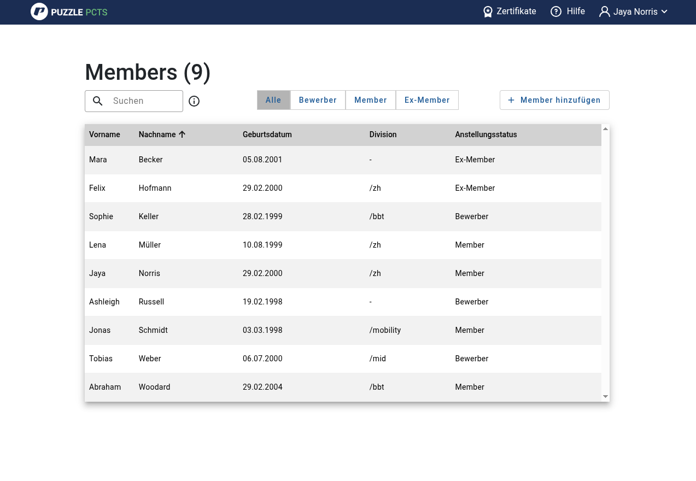

# 

[](https://github.com/puzzle/pcts/issues)


[](https://www.gnu.org/licenses/agpl-3.0)


PCTS stands for Puzzle ECTS, inspired by the
[European Credit Transfer and Accumulation System](https://en.wikipedia.org/wiki/European_Credit_Transfer_and_Accumulation_System).

We use the PCTS points to track which employees have what
training, certificates, experience, further education and adjust the salaries
according to that.



## Documentation

See our Backend documentation: [Backend](backend/README.md)

See our Frontend documentation: [Frontend](frontend/README.md)

See our Migration tool documentation: [Migration tool](migration/README.md)

## Packages

You can find the PCTS Docker images on the [Packages page of our GitHub repository](https://github.com/puzzle/pcts/packages).
There are separate images for the frontend and backend components.

Note: When running the backend image, make sure to specify a Spring Profile to configure the application correctly.

## Running the Application

To start the application with Docker, navigate to the `/docker` directory.

There are different profiles available.

**Full-stack:**

```shell
  docker compose up
```

**Backend and DB:**

```shell
  docker compose --profile backend up
```

**Only DB:**

```shell
  docker compose --profile db up
```

**Migration Tool:**

```shell
  docker compose --profile migration up
```

## Changelog

See what’s new in the latest versions by checking the [CHANGELOG.md](https://github.com/puzzle/pcts/blob/main/CHANGELOG.md).

## Contributing

See [CONTRIBUTING.md](CONTRIBUTING.md).

## License

[AGPL v3](LICENSE) @ Puzzle ITC
