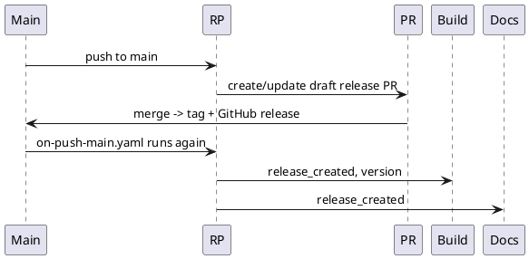

# Release

Releases are automated with [release-please](https://github.com/googleapis/release-please).

Based on commits since the last release, it maintains a single draft
"chore: release" PR that updates `CHANGELOG.md` and bumps the version in the appropriate places.

Merging that PR tags the release and re-triggers the pipelines, building images and publishing the docs.

