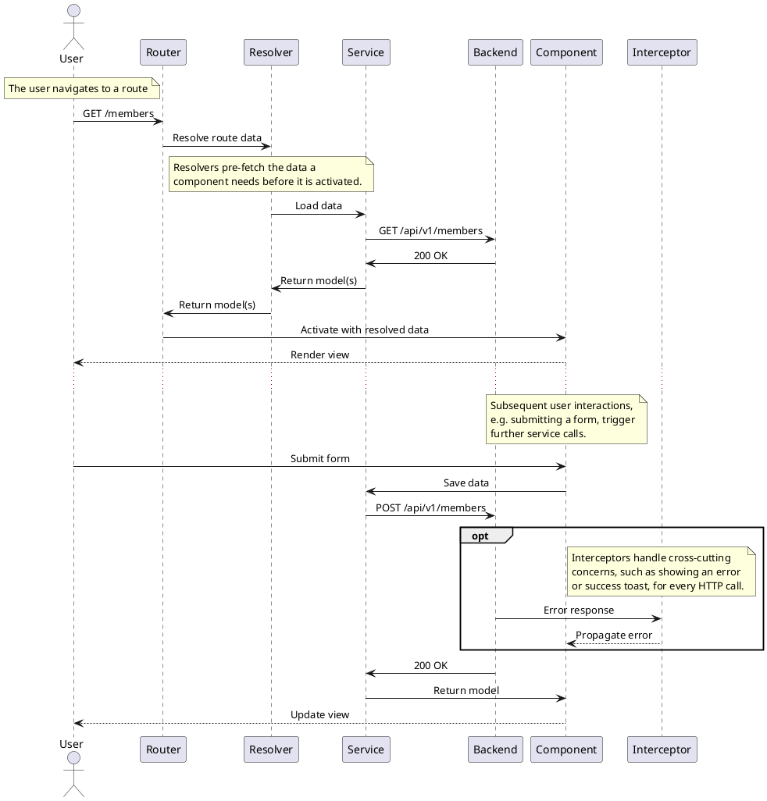

# Frontend Overview

The frontend is structured into the following levels:

- `Resolver`: pre-fetches the data a route needs before its component is activated
- `Component`: renders the UI, reacts to user input and injects the services it needs
- `Service`: communicates with the backend REST API via `HttpClient` and maps between DTOs and models
- `DTO`: the shape of data as sent to/received from the backend
- `Model`: the shape of data as used within the frontend application
- `Interceptor`: handles cross-cutting concerns for every HTTP request/response, e.g. `error-interceptor` and `success-interceptor`

A hypothetical request is plotted in the diagram below. Note that
some calls are optional.

